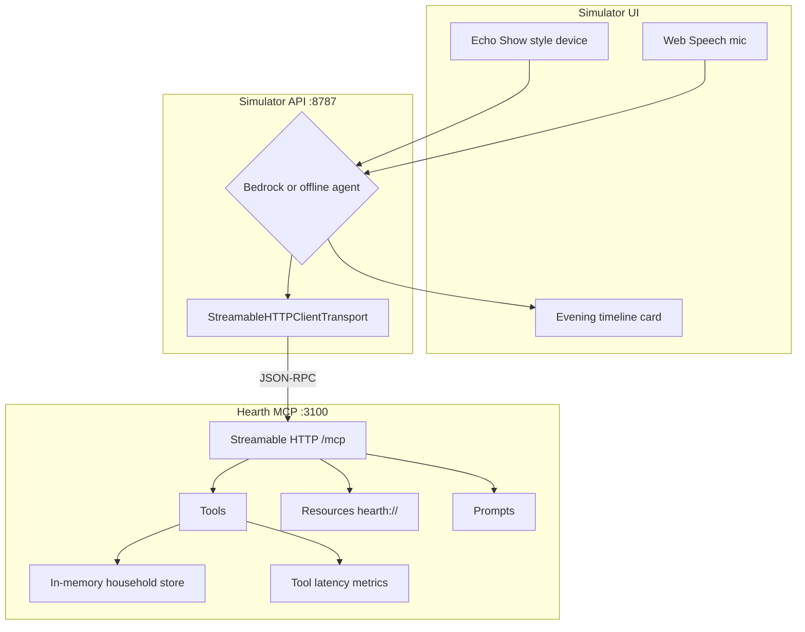

# Hearth architecture

## Tracks

- **Primary:** Alexa+ — MCP server (spec `2025-11-25`, Streamable HTTP) + web device simulator
- **Mini:** AWS Builder — Amazon Bedrock Converse tool-use loop (offline MCP router fallback)

## System diagram

## Packages

| Path                              | Role                                                           |
| --------------------------------- | -------------------------------------------------------------- |
| `packages/shared`                 | Shared types, scenarios, protocol version constant             |
| `mcp-server`                      | Express + MCP SDK Streamable HTTP server                       |
| `simulator`                       | Vite/React device UI + Express agent API                       |
| `oss/streamable-http-mcp-starter` | Standalone OSS starter (publish separately for mini-challenge) |

## Runtime flow

1. UI sends `{ message, scenario }` to `POST /api/chat`.
2. Agent selects tools (Bedrock Converse or deterministic offline router).
3. Each tool call goes to `http://127.0.0.1:3100/mcp` via MCP SDK client (session header handled by transport).
4. Tools personalize plans from Rivera household seed data and record latency samples.
5. UI renders reply, animated tool calls, timeline/chips/why-for-member notes, and latency badge.

## MCP contract

- **Transport:** Streamable HTTP (`POST`/`GET`/`DELETE` `/mcp`)
- **Protocol:** `2025-11-25`
- **Tools:** `get_household_profile`, `suggest_evening_plan`, `create_reminder`, `log_care_checkin`, `confirm_plan`, `get_evening_state`
- **Resources:** `hearth://protocol`, `hearth://household`, `hearth://evening-state`, `hearth://scenarios`
- **Prompts:** `evening_briefing`, `care_checkin_script`
- **Latency target:** Alexa+ round-trip guidance &lt; 500 ms (exposed on `/health`)

## Local vs Alexa+ cloud

| Mode           | What runs                                                                                    |
| -------------- | -------------------------------------------------------------------------------------------- |
| Local demo     | MCP + simulator on localhost (`npm run demo`)                                                |
| Docker         | Same stack via Compose                                                                       |
| Alexa+ preview | Tunnel MCP with cloudflared, then `alexa-ai` add-on deploy (see `docs/ALEXA_PLUS_TUNNEL.md`) |

## Design choices

- **In-memory store** keeps the demo deterministic and PC-only.
- **Offline agent** guarantees a working video even without AWS credentials.
- **Personalization in `suggest_evening_plan`** (not only in LLM text) so judges see structured MCP value in the tool panel.
